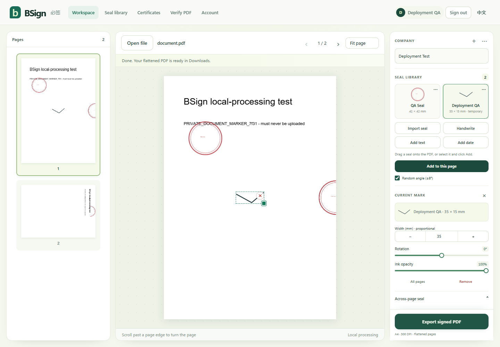
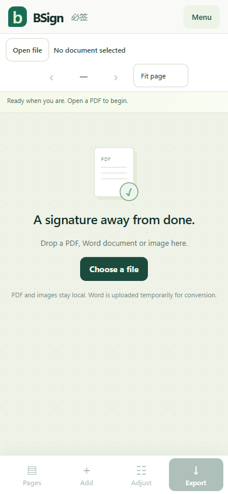

# BSign / 必签

**在浏览器中为 PDF 加盖公章、添加签名，并导出完成后的文件。**

BSign 是一款可自行部署的中英文 PDF 盖章与签名工具。适合日常文书、证明、申请材料等文件的签章处理，支持保存常用印章、手机手写签名和多页骑缝章。

## 原版完整版开源

**BSign 标准版原版完整版开源，非功能阉割版。** 本仓库提供标准版完整的前端、后端与部署脚本，涵盖文档盖章、印章库、手写签名、骑缝章、数字证书签署及验证，可自行部署使用。

这里的「完整版」指标准版的完整功能范围；专业版的远程合同、支付、短信和实名核验服务不在本仓库范围内。Word 转换需按部署指南额外配置。

## 界面预览

### 电脑端：盖章与签名工作区

页面缩略图、文档预览和签章设置集中在同一工作区，可直接调整印章、签名及骑缝章位置。



### 手机端：文档工作区

手机浏览器提供页面、添加、调整和导出入口，方便在小屏幕上处理文件。



截图使用演示账号与测试文档。

## 可以做什么

- **文件盖章**：打开 PDF、JPG 或 PNG，导入公章图片，拖动到需要的位置。
- **手写签名**：在电脑上书写，或用手机扫码签名，再添加到文件中。
- **印章库**：按企业或项目保存常用印章和签名，下次登录可继续使用。
- **位置调整**：调整旋转角度和印迹浓度，按毫米设置尺寸；签名支持等比例缩放。
- **多页处理**：浏览页面、将签章复制到全部页面，或添加骑缝章。
- **文字与日期**：添加文字和多种格式的日期。
- **数字签名**：使用 P12/PFX 证书签署 PDF，并通过验证页面检查文件完整性。
- **电脑与手机**：支持中英文切换和手机浏览器操作。

## 开始使用

打开已部署的 BSign 网站，注册普通账号并登录。注册时需要接收邮箱验证码；未收到邮件时，请检查垃圾邮件，或联系网站管理员确认发信服务是否可用。

### 1. 打开文件

在工作区点击「打开文件」，选择 PDF、JPG 或 PNG。也可以在电脑上将文件拖入文档区域。

多页 PDF 可以通过页面缩略图或翻页按钮切换。建议保留一份原始文件，签章完成后另存导出结果。

### 2. 准备公章或签名

首次使用时，先创建一个企业或项目，用来归类印章。

- **公章图片**：点击「导入印章」，选择图片，填写名称、类型和实际尺寸。透明背景的 PNG 通常更便于叠加。
- **手写签名**：点击「手写签名」，在画板上书写；也可以选择手机扫码，在手机上完成签名。
- **常用素材**：勾选保存到印章库后，可以在以后登录时再次使用。临时素材请在关闭工作区前完成导出。

公章尺寸使用毫米。例如，实际直径为 42 毫米的圆章，应将宽度设为 42 毫米。

### 3. 放置与调整

在电脑上，将印章或签名拖到页面的目标位置；也可以选中素材后点击「添加到当前页」。在手机上，按页面提示选择素材并放置。

选中已放置的签章后，可以移动、旋转、调整浓度或移除。签名支持等比例缩放；公章请在素材设置中填写准确尺寸。

需要在每页的相同位置盖章时，使用「复制到全部页」。需要骑缝章时，选择公章，展开「骑缝章」设置，再调整距页面顶部的位置。骑缝章适用于多页文件。

### 4. 导出文件

检查各页的位置和尺寸后，点击「导出签章 PDF」，将结果下载到设备。

**导出结果为 A4、300 DPI 的图片型 PDF。** 原文件的可选择文字层、表单交互及原有数字签名不会保留。若需要保留原有数字签名或可编辑结构，请先确认这种导出方式是否满足要求。

## 使用数字证书

普通盖章和手写签名无需配置数字证书。需要对导出文件加数字签名时，可以在「证书」页面管理证书，或在导出时使用自己的 P12/PFX 证书。

证书签署完成后，可在「验证 PDF」页面检查数字签名与文件完整性。可见的公章图片与数字证书签名是两种不同功能。

本部署签发的私有 CA 证书或自签证书，可能不会被其他 PDF 阅读器自动信任。文件完整性验证不等于签署人身份认证；对证书可信度有要求时，请使用接收方认可的证书。

## 文件与数据

| 内容 | 处理方式 |
| --- | --- |
| 导入的 PDF、JPG、PNG 文档 | 在浏览器中处理，文档内容不上传服务器 |
| 导出的签章 PDF | 在浏览器中生成并下载到设备 |
| 保存到印章库的公章与签名 | 上传到当前网站服务器，加密保存，按账号隔离 |
| 手机扫码签名 | 通过当前网站服务器传递给工作区 |
| 托管的数字证书 | 上传到当前网站服务器，加密保存 |

网站运营者管理服务器及其加密密钥。请选择可信的部署环境，并妥善保管账号、印章和证书。

## 常见问题

**可以处理 Word 文件吗？**

默认部署支持 PDF、JPG 和 PNG。Word 转换需要管理员额外安装转换服务；网站未启用时，请先将 Word 导出为 PDF 再使用。启用后，Word 文件会上传服务器进行转换。

**关闭页面后，签章位置还在吗？**

当前打开的文档及尚未导出的签章位置不会作为项目保存在服务器。请在关闭或刷新页面前导出。已保存到印章库的素材可以在下次登录后继续使用。

**为什么管理员登录后没有盖章工作区？**

管理员账号用于管理用户。需要处理文件时，请使用另一个邮箱注册普通账号。

**为什么导出后无法选择原来的文字？**

BSign 将页面与签章合成为图片型 PDF，因此不保留原来的文字层。请保留原始文件用于后续修改。

**盖章后能直接用于所有正式文件吗？**

请按文件接收方的要求确认签章形式、尺寸及证书要求。BSign 提供文件处理功能，不提供实名认证或公开可信的身份认证服务。

## 自行部署

需要独立使用或为团队提供服务时，可以将 BSign 部署到自己的服务器。

Ubuntu / Debian 服务器将源码放到 `/opt/BSign`，将域名解析到服务器并放行 80、443 端口后，执行：

```bash
cd /opt/BSign
sudo bash deploy/install.sh --domain sign.example.com --email ops@example.com
```

将示例域名和邮箱替换为自己的信息。脚本会安装所需的 Docker 环境、生成配置、启动应用，并申请 HTTPS 证书。已有宝塔或 Nginx 的服务器使用 `--behind-proxy` 模式。

普通用户注册和密码恢复需要配置 Resend 发信服务。管理员首次设置、邮件配置、反向代理、更新及备份恢复的完整步骤见 **[部署指南](docs/DEPLOY.md)**。

## 许可

BSign 源代码采用 [ISC 许可证](LICENSE)。第三方组件许可见 [THIRD_PARTY_NOTICES.md](THIRD_PARTY_NOTICES.md)。
